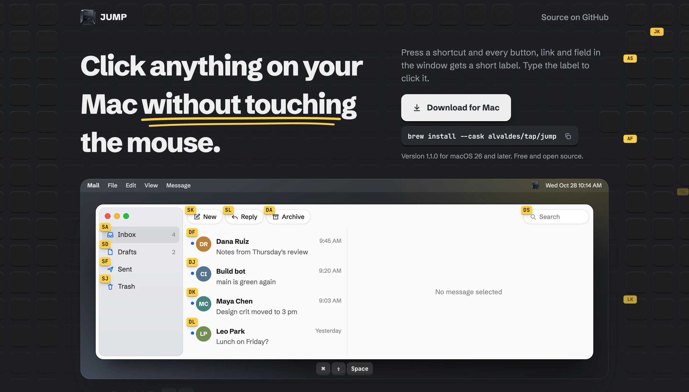
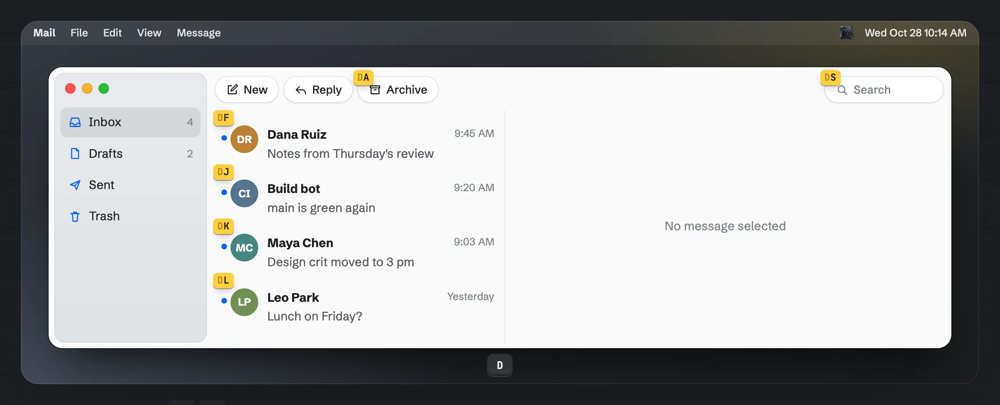
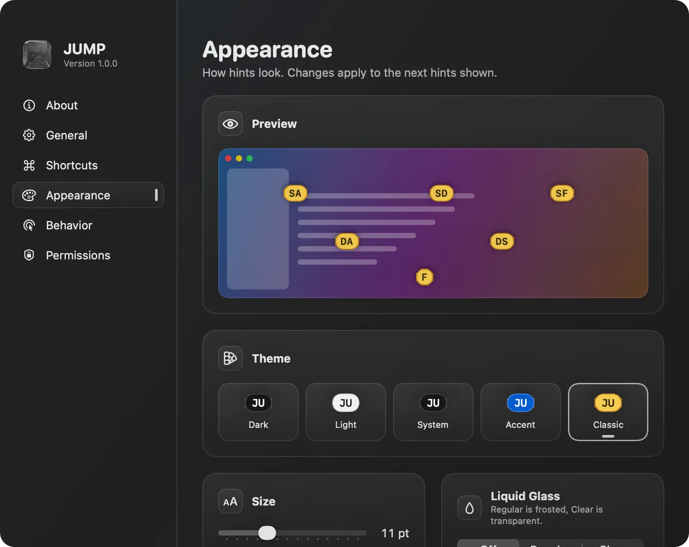
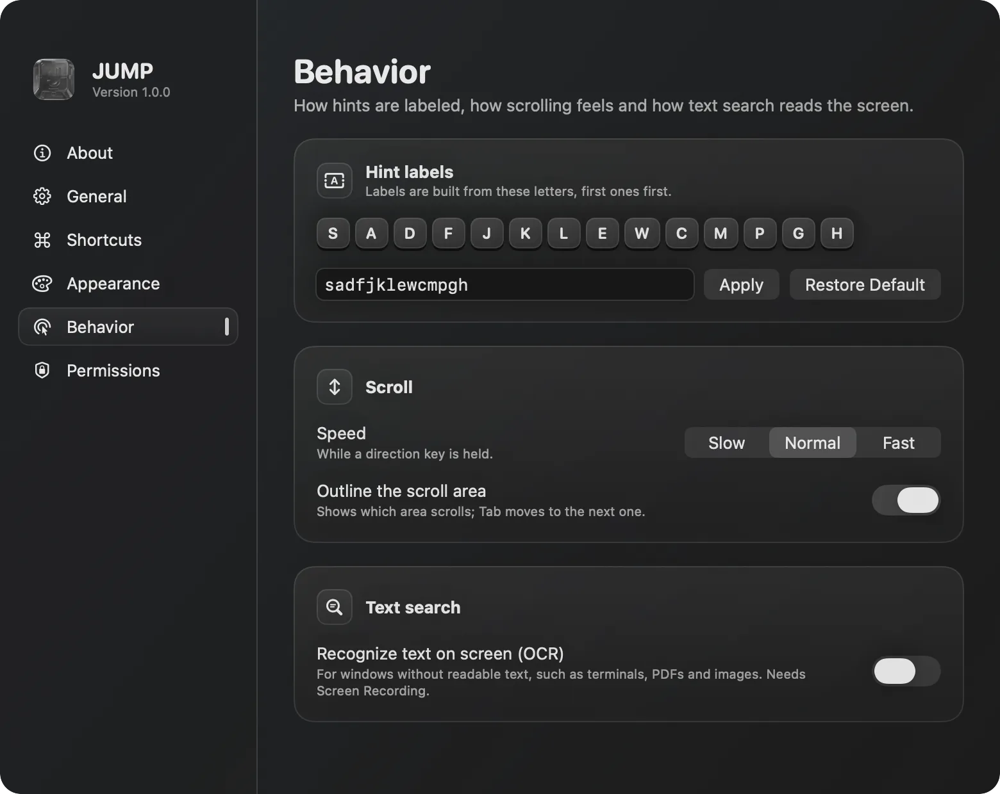
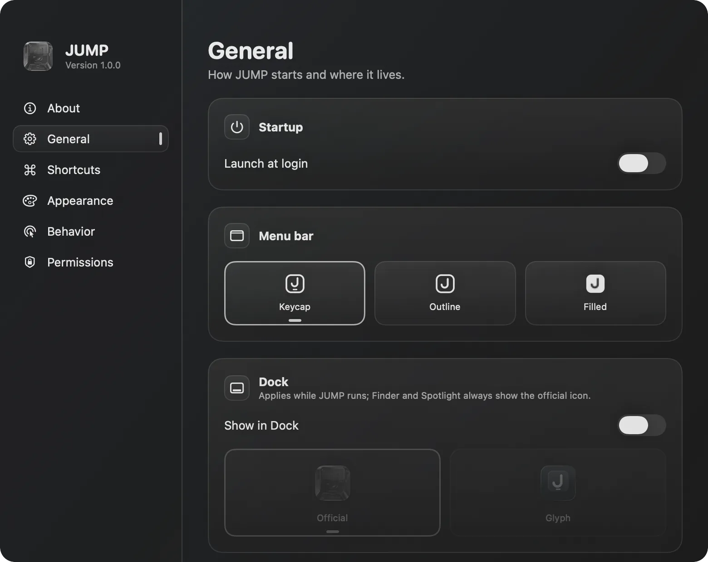
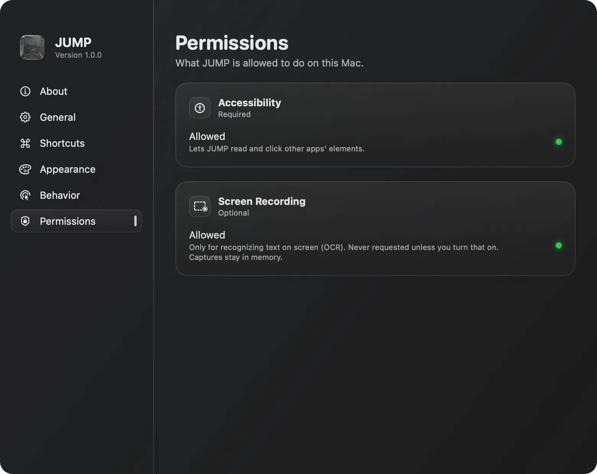

# JUMP

Keyboard-driven screen navigation for macOS. Press a shortcut, every clickable element gets a short label, type the label to click it. No mouse required.

<p>
  <a href="https://alvaldes.github.io/jump/"><picture><source media="(prefers-color-scheme: dark)" srcset="docs/assets/badges/website-dark.svg"></picture></a>
  <a href="https://github.com/alvaldes/jump/releases/latest/download/JUMP.dmg"><picture><source media="(prefers-color-scheme: dark)" srcset="docs/assets/badges/download-dark.svg"></picture></a>
  <a href="https://www.producthunt.com/products/jump-9?embed=true&amp;utm_source=badge-featured&amp;utm_medium=badge&amp;utm_campaign=badge-jump-78bc837b-e350-4f45-953f-7f61e183414d"><picture><source media="(prefers-color-scheme: dark)" srcset="https://api.producthunt.com/widgets/embed-image/v1/featured.svg?post_id=1296237&amp;theme=dark&amp;t=1793287748983"></picture></a>
</p>

[](https://alvaldes.github.io/jump/)

> Status: v1.1.0 (not yet notarized). See [`my-idea.md`](my-idea.md) for the design spec and roadmap.

## Install

JUMP needs macOS 26 or later.

1. Download [JUMP.dmg](https://github.com/alvaldes/jump/releases/latest/download/JUMP.dmg), open it and drag JUMP to Applications. Or install it with [Homebrew](https://brew.sh):

   ```sh
   brew install --cask alvaldes/tap/jump
   ```

2. Open JUMP from Applications. JUMP isn't notarized by Apple yet, so macOS stops it the first time: choose **Done**, then open System Settings → Privacy & Security and click **Open Anyway** next to “JUMP.app” was blocked. The [step-by-step guide](https://alvaldes.vercel.app/en/blog/open-unnotarized-mac-apps/) has screenshots.
3. Allow JUMP in **Accessibility** when it asks (System Settings → Privacy & Security → Accessibility).
4. Press ⌘⇧Space in any window.

## Features



Each key narrows the labels. After `D`, only the six that start with D are left, and the next key clicks one. The [website](https://alvaldes.github.io/jump/) has this demo running live.

| Shortcut | Mode | What it does |
|---|---|---|
| ⌘⇧Space | Hints | Labels every clickable element of the focused window. Type a label to click it. |
| ⌘⇧J | Scroll | Scrolls the focused window without the mouse: `h j k l`, `d u`, `gg G`, `Tab` to change area, `Esc` to leave. |
| ⌘⇧F | Text search | Finds visible text in the focused window. `Tab` / `Shift-Tab` move between matches, `Return` jumps, `Esc` leaves. |

All three shortcuts can be changed in Settings. Inside any mode, `⌘,` leaves it and opens Settings. Apps listed under Excluded apps (Settings, Shortcuts) keep those keys: JUMP's shortcuts stay off while one of them is in front.

- **Actions with modifiers.** Holding a modifier while typing a label (or pressing `Return` in text search) chooses the action: none clicks (or places the caret in a text field), `Shift` right-clicks, `⌘` double-clicks, `⌥` only moves the pointer. Each action's modifier (`Shift`, `⌃`, `⌥` or `⌘`) can be changed in Settings, Behavior. Clicks wait until the modifier is released, so apps never see it.
- **Text search** reads text through Accessibility. Matching ignores case and accents, and only counts what is on screen.
- **OCR fallback (optional).** For windows without usable Accessibility text (terminals, PDFs, images), JUMP can recognize text on screen. It is off by default and needs the Screen Recording permission, requested only when you turn it on. Captures never leave memory.
- **Appearance.** Five hint themes (Dark, Light, System, Accent, Classic) with readable contrast, label size from 7 to 20 pt, upper or lower case labels, and Liquid Glass (Off, Regular, Clear). Scroll speed (Slow, Normal, Fast) and the scroll area outline can be changed in Behavior.
- **App.** Three menu bar icons, optional Dock icon (official or glyph), launch at login.
- **Leaves the mode when focus moves**, whether by mouse, ⌘-Tab, ⌘\` or a window manager such as AeroSpace.

## Screenshots

| Appearance | Behavior |
|---|---|
|  |  |
| **General** | **Permissions** |
|  |  |

## Permissions

- **Accessibility** (required): to read and act on other apps' elements.
- **Screen Recording** (optional): only for the OCR fallback.

## Requirements

- macOS 26 or later
- Xcode 27 or later
- [XcodeGen](https://github.com/yonaskolb/XcodeGen): `brew install xcodegen`

## Build

```sh
xcodegen generate        # creates JUMP.xcodeproj (not committed)
open JUMP.xcodeproj
```

Core logic lives in the `JumpKit` Swift package and is tested without launching the app:

```sh
swift test --package-path Packages/JumpKit
```

### Code signing (important for development)

JUMP needs the Accessibility permission, and macOS ties that permission to the app's code signature. The default ad-hoc signature changes on every build, so the permission is lost after each rebuild.

To keep it, sign with your own (free) Apple Development certificate:

1. Xcode → Settings → Accounts → add your Apple ID.
2. `cp Config/Signing.local.xcconfig.example Config/Signing.local.xcconfig`
3. Set your `DEVELOPMENT_TEAM` in that file (it is git-ignored).
4. `xcodegen generate`

### Releasing

1. Bump `MARKETING_VERSION` and `CURRENT_PROJECT_VERSION` in `project.yml`, commit, and tag the commit `v<version>`.
2. `scripts/release.sh` builds the signed Release app and writes `dist/JUMP.dmg` (a fixed name, so the website's download link always gets the latest release). It refuses uncommitted changes, an untagged commit, and an ad-hoc signature (users would lose the Accessibility permission on every update).
3. Push the tag, then `scripts/release.sh --upload` attaches the disk image to the GitHub release, creating the release if needed, and updates the version and sha256 of the Homebrew cask in [alvaldes/homebrew-tap](https://github.com/alvaldes/homebrew-tap).

Until JUMP is notarized, macOS asks people to confirm the first launch; [Install](#install) walks through it.

## Project layout

```
JUMP/                 macOS app target (SwiftUI menu bar agent)
Packages/JumpKit/     core logic as a Swift package (testable without the app)
Config/               shared and local build settings
project.yml           XcodeGen project definition
```

## Credits

JUMP builds on ideas and code from [Vimac](https://github.com/nchudleigh/vimac) by Dexter Leng and contributors (GPL-3.0), the open-source predecessor of [Homerow](https://www.homerow.app).

## License

[GPL-3.0](LICENSE)
